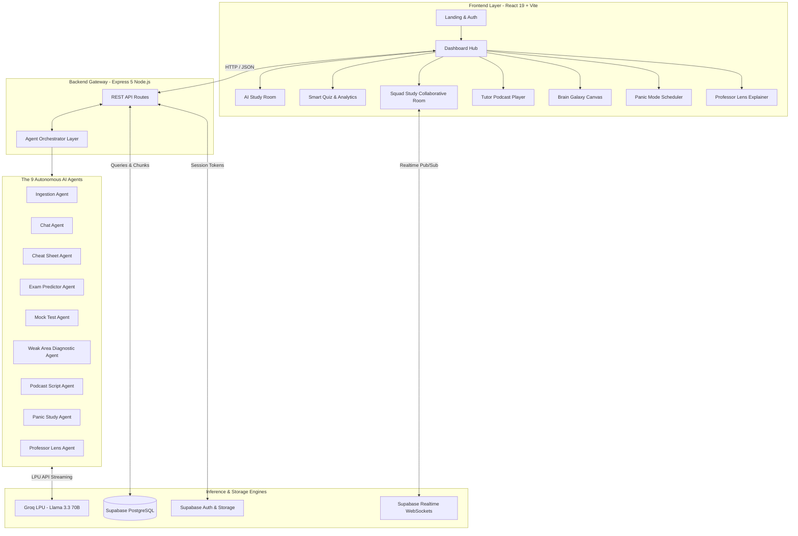

<div align="center">

<br/>


# LearnLens
### Next-Gen Agentic EdTech Platform — 9 Autonomous AI Agents, 1 PDF, Infinite Learning

<p align="center">
  <b>Official Showcase & Technical Demonstration for TechXConf 2026</b>
</p>

<table>
  <tr>
    <td align="center"><a href="https://github.com/JexanJoel/LearnLens"></a></td>
    <td align="center"></td>
    <td align="center"></td>
    <td align="center"><a href="LICENSE"></a></td>
  </tr>
</table>

<br/>

</div>

---

## 📌 Executive Summary (TechXConf 2026)

Students, researchers, and professionals face severe cognitive overload when reading dense academic papers, textbooks, and technical documentation. Traditional study methods rely on passive re-reading—yielding poor retention and high dropout rates.

**LearnLens** reimagines computer-assisted education with an **autonomous 9-agent micro-architecture** powered by **Groq LPU hardware acceleration** and **Llama 3.3 70B**. By ingesting a single PDF, LearnLens orchestrates a multi-agent pipeline that transforms static text into an interactive, multi-modal learning experience:

- 📖 **RAG-Powered AI Study Room** grounded exclusively in the uploaded material (zero hallucinations).
- ⚡ **Instant Cheat Sheets & Exam Predictors** calculating question probabilities and confidence ratings.
- 📝 **Adaptive Timed Quizzes** with automated post-quiz gap analysis and instant revision loops.
- 🤝 **Real-Time Squad Study** enabling multi-user collaborative rooms with synchronized AI responses.
- 🎙️ **Zero-Cost Dual-Voice Podcasts** generated on-the-fly and synthesized via the native Web Speech API.
- 🌌 **Brain Galaxy Visual Topology** mapping user knowledge graphs on dynamic HTML5 Canvas.
- 🚨 **Panic Mode** crafting time-budgeted, phase-by-phase emergency cramming schedules.
- 🎮 **Study RPG Mechanics** reinforcing continuous learning through XP leveling curves and achievements.

---

## 🚀 TechXConf Innovation Highlights

<table width="100%">
<tr>
  <th width="30%" align="left">Innovation Pillar</th>
  <th width="70%" align="left">Technical Breakthrough</th>
</tr>
<tr>
  <td>⚡ <b>Ultra-Low-Latency Inference</b></td>
  <td>Leverages <b>Groq LPU (Language Processing Unit)</b> running <code>Llama-3.3-70b-versatile</code> to achieve sub-second JSON response generation (~300 tokens/sec), eliminating traditional LLM latency bottlenecks in real-time user workflows.</td>
</tr>
<tr>
  <td>🧠 <b>Specialized 9-Agent Topology</b></td>
  <td>Rather than relying on monolithic prompts, LearnLens decomposes cognitive study tasks into 9 targeted, deterministic agents with structured JSON contracts, ensuring predictability, explainability, and speed.</td>
</tr>
<tr>
  <td>🤝 <b>Real-Time Collaborative RAG</b></td>
  <td>Powered by <b>Supabase Realtime</b> WebSockets, multiple students in a Squad Session share synchronized presence, chat streams, and broadcasted AI agent responses simultaneously.</td>
</tr>
<tr>
  <td>🎙️ <b>Bandwidth-Zero Audio Synthesis</b></td>
  <td>Generates dual-speaker dialogic scripts (Host vs. Professor) rendered entirely on the client using the browser's <b>Web Speech API</b>, enabling free, instant audio learning without third-party TTS bills or cloud audio streaming lag.</td>
</tr>
<tr>
  <td>🌌 <b>Vector-Agnostic Knowledge Graphs</b></td>
  <td>Implements an interactive particle and orbital topology engine rendered directly on <b>HTML5 Canvas</b>, dynamically scaling document nodes in real time based on user mastery and quiz performance.</td>
</tr>
<tr>
  <td>🎨 <b>Handcrafted Design System</b></td>
  <td>Built without heavyweight CSS utility frameworks; utilizes a high-performance Vanilla CSS token system with DM Sans typography, dark-mode glassmorphism, responsive touch states, and buttery micro-animations.</td>
</tr>
</table>

---

## 🎬 Live Demo & Media

<div align="center">

[](https://youtu.be/ROrWnkFICtQ)

*Click above to watch the technical walkthrough and live feature demonstration.*

</div>

---

## 📸 Platform Interface

<div align="center">

| **Landing & Experience** | **Dashboard & Knowledge Library** |
|:---:|:---:|
|  |  |

| **AI Study Room (Grounded RAG)** | **Cheat Sheet Generator** |
|:---:|:---:|
|  |  |

| **Exam Question Predictor** | **3D Interactive Flashcards** |
|:---:|:---:|
|  |  |

| **Adaptive Timed Quiz** | **Diagnostic Results & Revision** |
|:---:|:---:|
|  |  |

| **Squad Study (Live WebSockets)** | **Tutor Podcast (Dual-Voice TTS)** |
|:---:|:---:|
|  |  |

| **Brain Galaxy (Canvas Graph)** | **Professor Lens (Text & Vision AI)** |
|:---:|:---:|
|  |  |

| **Panic Mode (AI Study Scheduler)** | **Study RPG & Gamification** |
|:---:|:---:|
|  |  |

</div>

---

## 🏗️ System Architecture



### Architectural Pipeline
1. **Document Ingestion**: PDF uploads stream to Express, parsed via `pdf-parse`, chunked by token boundary heuristics, and cataloged in Supabase PostgreSQL (`pdfs`, `pdf_chunks`).
2. **Contextual Retrieval (RAG)**: User queries trigger targeted chunk retrieval. Chunks + system directives feed into Groq Llama 3.3 70B with strict grounding rules to eradicate model hallucinations.
3. **Structured JSON Output**: Every agent enforces strict JSON schemas, enabling deterministic frontend hydration for timers, cards, flashcards, and script readers.
4. **Realtime Multi-Tenant Sync**: Squad rooms establish dedicated Supabase Realtime broadcast channels with presence tracking and shared state distribution.

---

## 🤖 The 9 Autonomous AI Agents

<div align="center">

| Agent | Responsibility | Ingestion Source | Output Schema |
|:---|:---|:---|:---|
| 🧩 **Ingestion Agent** | Splits documents into semantic chunks | Raw PDF stream | `pdf_chunks` relational records |
| 💬 **Chat Agent** | RAG-grounded contextual Q&A | Query + relevant chunks | Markdown-formatted factual response |
| ⚡ **Cheat Sheet Agent** | High-density formula and concept extraction | Document chunks | JSON `[concepts, formulas, key_facts]` |
| 🔮 **Exam Predictor Agent** | Questions analysis and probability scoring | Document chunks | JSON `[question, probability, confidence_rationale]` |
| 📝 **Mock Test Agent** | Difficulty-adjusted MCQ generation | Document chunks + tier | JSON `[question, options[], correct_index, explanation]` |
| 🔍 **Weak Area Agent** | Diagnostic cognitive gap discovery | Missed quiz answers | JSON `[weak_topics[], remediation_actions[]]` |
| 🎙️ **Podcast Agent** | Conversational script writing | Document chunks | JSON `[speaker: "host"\|"professor", dialog]` |
| 🚨 **Panic Agent** | Time-budgeted Pareto principle schedule | Document chunks + hours | JSON `[phases[], target_milestones[], countdown_mins]` |
| 🔭 **Lens Agent** | Instant concept simplification & OCR parsing | Pasted text / Camera input | JSON `[cleaned_text, simplified_explanation]` |

</div>

---

## 💻 Tech Stack & Engineering Specifications

- **Frontend**:
  - React 19, Vite, React Router DOM
  - Handcrafted Vanilla CSS Design System (Design Tokens, Responsive CSS Grid & Flexbox)
  - Typography: Google Fonts (DM Sans)
  - HTML5 Canvas (Dynamic Orbital Particle System for Brain Galaxy)
  - Web Speech API (Client-side SpeechSynthesis TTS)
  - canvas-confetti (Reward micro-interactions)
- **Backend**:
  - Node.js & Express.js 5
  - Groq SDK (`groq-sdk`, `@ai-sdk/groq`, `@mastra/core`)
  - PDF Parsing (`pdf-parse`, `multer`)
  - Cross-Origin Resource Sharing (`cors`), `dotenv`
- **Data & Cloud Infrastructure**:
  - Supabase PostgreSQL (Relational schema, indexing)
  - Supabase Auth (JWT session management)
  - Supabase Storage (Original document persistence)
  - Supabase Realtime (WebSockets for Squad Study presence & broadcasts)
- **Inference Engine**:
  - Model: Configurable via `GROQ_MODEL` (default: `qwen/qwen3.8-27b` / `llama-3.3-70b-versatile`) running on Groq LPU hardware

---

## 📂 Project Structure

```
learnlens/
├── .gitignore                   # Workspace gitignore (secrets, node_modules, build assets)
├── README.md                    # TechXConf documentation & architecture overview
├── assets/                      # Media assets, thumbnails, and platform screenshots
│   ├── demo-thumbnail.png
│   └── screenshots/             # Interface captures for all core modules
├── backend/
│   ├── .env.example             # Backend environment variable template
│   ├── package.json             # Express dependencies & scripts
│   └── src/
│       ├── agents/              # The 9 autonomous AI agents
│       │   ├── ingestionAgent.js
│       │   ├── chatAgent.js
│       │   ├── cheatSheetAgent.js
│       │   ├── examPredictorAgent.js
│       │   ├── mockTestAgent.js
│       │   ├── weakAreaAgent.js
│       │   ├── podcastAgent.js
│       │   ├── panicAgent.js
│       │   └── lensAgent.js
│       ├── routes/              # Modular Express routing
│       │   ├── pdf.js           # PDF upload, chunking, and deletion
│       │   ├── chat.js          # RAG chat endpoint
│       │   ├── quiz.js          # Quiz generation, scoring, and history
│       │   ├── study.js         # Cheat sheets, predictor, podcast, panic, lens
│       │   └── gamification.js  # XP calculation, levels, and badge awards
│       └── index.js             # API entrypoint & middleware configuration
└── frontend/
    ├── .env.example             # Frontend environment variable template
    ├── package.json             # React 19 dependencies & scripts
    ├── vite.config.js           # Vite configuration
    ├── index.html               # Single page application HTML shell
    └── src/
        ├── App.jsx              # Application router (11 client routes)
        ├── lib/
        │   ├── api.js           # Axios HTTP client configuration
        │   └── supabase.js      # Supabase client initialization
        └── pages/               # React views & component styles
            ├── Landing.jsx/css
            ├── Auth.jsx/css
            ├── Dashboard.jsx/css
            ├── StudyRoom.jsx/css
            ├── Quiz.jsx/css
            ├── Results.jsx/css
            ├── SquadStudy.jsx/css
            ├── Podcast.jsx/css
            ├── BrainGalaxy.jsx/css
            ├── ProfLens.jsx/css
            └── PanicMode.jsx/css
```

---

## ⚡ Quick Start for Evaluators & Developers

### 1. Clone & Setup Repository

```bash
git clone https://github.com/JexanJoel/LearnLens.git
cd LearnLens
```

### 2. Configure Environment Variables

**Backend (`backend/.env`):**
```env
PORT=5000
SUPABASE_URL=https://your-project.supabase.co
SUPABASE_SERVICE_KEY=your-supabase-service-role-key
GROQ_API_KEY=your-groq-api-key
GROQ_MODEL=qwen/qwen3.8-27b
```

**Frontend (`frontend/.env`):**
```env
VITE_SUPABASE_URL=https://your-project.supabase.co
VITE_SUPABASE_ANON_KEY=your-supabase-anon-key
VITE_API_URL=http://localhost:5000/api
```

### 3. Database Migration (Supabase SQL Editor)

Execute the following DDL in your Supabase SQL editor:

```sql
-- Documents & Ingested Content
CREATE TABLE IF NOT EXISTS pdfs (
  id uuid PRIMARY KEY DEFAULT gen_random_uuid(),
  user_id uuid NOT NULL,
  filename text NOT NULL,
  created_at timestamptz DEFAULT now()
);

CREATE TABLE IF NOT EXISTS pdf_chunks (
  id uuid PRIMARY KEY DEFAULT gen_random_uuid(),
  pdf_id uuid REFERENCES pdfs(id) ON DELETE CASCADE,
  content text NOT NULL
);

-- Assessment & Diagnostic Analytics
CREATE TABLE IF NOT EXISTS quiz_results (
  id uuid PRIMARY KEY DEFAULT gen_random_uuid(),
  pdf_id uuid REFERENCES pdfs(id) ON DELETE CASCADE,
  user_id uuid NOT NULL,
  score int NOT NULL,
  total int NOT NULL,
  weak_topics jsonb DEFAULT '[]'::jsonb,
  created_at timestamptz DEFAULT now()
);

-- Gamification & RPG Engine
CREATE TABLE IF NOT EXISTS gamification (
  user_id uuid PRIMARY KEY,
  xp int DEFAULT 0,
  level int DEFAULT 1,
  badges jsonb DEFAULT '[]'::jsonb,
  total_quizzes int DEFAULT 0,
  total_correct int DEFAULT 0,
  streak int DEFAULT 0
);
```

### 4. Run Application

```bash
# Terminal 1 - Backend Server
cd backend
npm install
npm run dev

# Terminal 2 - Frontend Client
cd frontend
npm install
npm run dev
```

Visit `http://localhost:5173` to experience LearnLens.

---

## 🗺️ Application Routes

<div align="center">

| Route | Page | Purpose |
|:---|:---|:---|
| `/` | **Landing Page** | Feature overview, conference presentation, quick jump |
| `/auth` | **Authentication** | Secure email/password login and registration |
| `/dashboard` | **Command Center** | Document library, upload dropzone, XP progression |
| `/study/:id` | **AI Study Room** | Grounded Q&A, Cheat Sheets, Exam Predictor, Flashcards |
| `/quiz/:id` | **Smart Quiz** | Timed difficulty-tuned MCQs with automated countdown |
| `/results/:id` | **Quiz Analytics** | Score breakdown, identified knowledge gaps, revision loops |
| `/squad/:id` | **Squad Study** | Multi-user study rooms with real-time AI broadcasts |
| `/podcast/:id` | **Tutor Podcast** | Dual-speaker dialogic audio player and interactive script |
| `/galaxy` | **Brain Galaxy** | Dynamic HTML5 Canvas document knowledge graph |
| `/lens` | **Professor Lens** | Paste/Camera instant AI explainer and simplifier |
| `/panic` | **Panic Mode** | Time-budgeted Pareto study scheduler with live phases |

</div>

---

## 🏆 TechXConf Presentation Team & Acknowledgements

- **Developer & Presenter**: [Jexan Joel J](https://github.com/JexanJoel)
- **Conference**: **TechXConf 2026**
- **Track**: AI & Intelligent Systems / Developer Innovation Showcase

<br/>

<div align="center">

<table>
  <tr>
    <td align="center"><a href="https://github.com/JexanJoel/LearnLens/issues"></a></td>
    <td align="center"><a href="https://github.com/JexanJoel/LearnLens/issues"></a></td>
    <td align="center"><a href="https://github.com/JexanJoel"></a></td>
  </tr>
</table>

<br/>

**LearnLens** — *Transforming passive reading into active, intelligent mastery.*

</div>
